# ARQUITETURA MOBILE — IBPJ MOBILE (`MOBILE_ARCHITECTURE.md`)

**Projeto:** IBPJ — Igreja Batista do Parque Jandaia  
**Conceito Visual & Experiência:** *IBPJ Mobile — Premium Glass Experience*  
**Identificador Android (`applicationId`):** `br.org.ibpj.mobile`  

---

## 1. Decisão Arquitetural: React + Capacitor vs. React Native + Expo

Conforme especificado na Seção 4 do Master Prompt, avaliamos rigorosamente as duas estratégias para transformar o sistema IBPJ em um aplicativo Android nativo instalável:

| Critério de Avaliação | Opção A: React 19 + Vite + Capacitor 7 | Opção B: React Native + Expo |
|---|---|---|
| **Reaproveitamento de Código** | **Altíssimo (~85% da lógica e entidades):** Preserva integralmente os serviços de API (`User`, `Evento`, `Postagem`), utilitários `date-fns`, validações e estrutura de estado React. | **Baixo (~25%):** Exigiria reescrever 100% dos componentes JSX (`div`, `button`, Tailwind CSS, Radix UI) para primitivos React Native (`View`, `Text`, `Pressable`, `StyleSheet`). |
| **Qualidade da Experiência Mobile (UX/UI)** | **Excelente para o conceito *Premium Glass Experience*:** O motor Chromium moderno do Android renderiza `backdrop-filter: blur()`, gradientes multicamada, bordas translúcidas (`glassmorphism`) e animações `framer-motion` com fidelidade superior e sem artefatos visuais. | **Complexa para Glassmorphism no Android:** O efeito `BlurView` no Android em React Native historicamente apresenta limitações de performance ou requer bibliotecas pesadas como `@shopify/react-native-skia`. |
| **Desempenho** | **Ótimo:** Bundle Vite otimizado, code-splitting, animações aceleradas por GPU (`transform`/`opacity`) e carregamento instantâneo de assets empacotados localmente no APK. | **Ótimo:** Renderização nativa de views, porém sem ganho perceptível para um app institucional orientado a conteúdo, calendário e formulários. |
| **Integração com API REST & Backend** | **Direta e testada:** Mantém o cliente HTTP `axios`, interceptors JWT e upload `multipart/form-data` para o `ibpj-api` existente. | **Requer adaptação:** `FormData` para upload de imagens no React Native exige tratamento específico de URI nativo. |
| **Acesso a Recursos Nativos Android** | **Completo via Plugins Oficiais Capacitor:** `@capacitor/app` (botão voltar Android), `@capacitor/preferences` (SharedPreferences nativo para sessão), `@capacitor/share` (compartilhamento nativo), `@capacitor/status-bar` e `@capacitor/splash-screen`. | **Completo via módulos Expo:** Equivalente para as necessidades do projeto. |
| **Manutenção e Evolução** | **Unificada:** Uma única base de código React serve tanto o aplicativo Android quanto a versão web responsiva, evitando duplicação de manutenção para a equipe da igreja. | **Fragmentada:** Criaria uma segunda base de código incompatível com o `front-ibpj` web. |
| **Geração e Distribuição de APK** | **100% Local e Controlável:** Gera um projeto Android nativo padrão (`android/`), compilável via Gradle (`gradlew assembleRelease` / `assembleDebug`) sem depender de filas em nuvem (EAS Build). | **Mais pesada localmente:** Requer prebuild nativo + NDK/CMake mais pesados ou conta externa no Expo EAS. |

### Decisão Fundamentada
Escolhemos a **Opção A — React + Vite + Capacitor**, combinada com uma **rearquitetura completa da camada de interface e navegação mobile**.  
Não faremos um "site dentro de uma WebView": o aplicativo terá cabeçalho nativo contextual, barra de navegação inferior fixa de 5 abas (`BottomNav`), transições fluidas, bottom sheets adaptados ao polegar, tratamento nativo do botão Voltar do Android, áreas seguras (`safe-area-inset`) e armazenamento nativo via `SharedPreferences` (`@capacitor/preferences`).

---

## 2. Arquitetura em Camadas do Aplicativo

A aplicação `Front/front-ibpj` foi organizada para separar claramente responsabilidades, preservando a compatibilidade com o repositório original:

```text
Front/front-ibpj/
├── android/                          # Projeto Android Nativo (Gradle + Capacitor)
│   └── app/
│       └── src/main/
│           ├── AndroidManifest.xml   # Permissões, cleartext HTTP dev, adjustResize
│           └── res/                  # Ícones mipmap e Splash Screen IBPJ
├── capacitor.config.json             # Configuração Capacitor (br.org.ibpj.mobile)
└── src/
    ├── api/
    │   └── core.js                   # Cliente Axios, resolução dinâmica de URL da API, interceptors JWT e status de rede
    ├── context/
    │   └── AuthContext.jsx           # Estado global de autenticação, sessão persistente (@capacitor/preferences) e permissões
    ├── entities/
    │   ├── User.js                   # Operações de autenticação, perfil, aniversariantes e administração de usuários
    │   ├── Evento.js                 # CRUD de eventos e listagem ordenada
    │   └── Postagem.js               # CRUD de postagens/programação e resolução de imagens
    ├── integrations/
    │   ├── Core.js                   # Upload multipart de imagens integrado à API configurada
    │   └── native.js                 # Integrações nativas Android (Share, External Links, Back Button, Clipboard, Storage)
    ├── utils/
    │   ├── index.js                  # Mapeamento de rotas e URLs de páginas
    │   └── date.js                   # Utilitários de data sem deslocamento de fuso UTC-3 (parseLocalDate, formatLocal)
    ├── components/
    │   ├── navigation/
    │   │   ├── MobileHeader.jsx      # Top App Bar com identidade IBPJ, status de sessão e ações rápidas
    │   │   └── BottomNav.jsx         # Barra de navegação inferior fixa (5 abas principais)
    │   ├── shared/
    │   │   ├── AuthForm.jsx          # Login e Cadastro mobile-first com validação e privacidade de aniversário
    │   │   ├── ApiConfigModal.jsx    # Configuração de endpoint da API (Emulador 10.0.2.2, IP LAN ou Produção)
    │   │   └── GlassPrimitives.jsx   # Componentes do Design System (GlassCard, SectionBadge, EmptyState, ErrorRetry)
    │   ├── eventos/
    │   │   ├── EventoCard.jsx        # Card mobile de evento com compartilhamento nativo e ações admin
    │   │   └── EventoForm.jsx        # Formulário mobile / sheet para criação e edição de eventos
    │   ├── programacao/
    │   │   ├── PostagemCard.jsx      # Card de publicação com visualização expandida e imagem otimizada
    │   │   └── PostagemForm.jsx      # Formulário mobile de publicação com upload de imagem
    │   ├── debug/
    │   │   └── DebugPanel.jsx        # Painel Administrativo Mobile (Eventos, Postagens, Usuários e Roles)
    │   └── ui/                       # Primitivos Radix UI / Shadcn estilizados com tokens IBPJ
    ├── pages/
    │   ├── Home.jsx                  # Central mobile da igreja (saudação contextual, próximo culto/evento, destaques, acesso rápido)
    │   ├── Eventos.jsx               # Calendário otimizado para toque com indicadores nos dias com eventos
    │   ├── Programacao.jsx           # Feed de programação e atividades da igreja com filtro rápido
    │   ├── Comunidade.jsx            # Hub comunitário (Aniversariantes, Ministérios/Voluntariado, Grupos, Kids, Oração, Galeria)
    │   ├── Aniversarios.jsx          # Mural de aniversariantes do mês com destaque para aniversariantes do dia
    │   ├── Generosidade.jsx          # Dízimos e ofertas (PIX, transparência e instruções)
    │   ├── Principios.jsx            # Princípios Batistas, Missão, Visão e Valores em formato acordeão/cards
    │   ├── QuemSomos.jsx             # História institucional, pilares e convite
    │   ├── Contato.jsx               # Localização, mapa interativo, abertura no Google Maps, horários e canais
    │   └── Mais.jsx                  # Hub de Perfil, Administração, Institucional e Configurações de Conexão
    ├── Layout.jsx                    # Shell Mobile Principal (Header + Viewport Rolável + BottomNav + Modais Globais)
    ├── App.jsx                       # Roteamento completo e listener do botão Voltar do Android
    └── index.css                     # Tokens CSS do Design System "IBPJ Mobile — Premium Glass Experience"
```

---

## 3. Arquitetura de Navegação Mobile

Para evitar menus escondidos ou excesso de itens na barra inferior, adotamos o padrão Android Material / iOS Human Interface de **5 destinos principais na Bottom Navigation**:

```mermaid
flowchart TD
    Shell["Layout Mobile (MobileHeader + BottomNav)"]
    
    Shell --> Tab1["1. Início (/)"]
    Shell --> Tab2["2. Eventos (/eventos)"]
    Shell --> Tab3["3. Programação (/programacao)"]
    Shell --> Tab4["4. Comunidade (/comunidade)"]
    Shell --> Tab5["5. Mais / Perfil (/mais)"]

    Tab1 --> QuickGen["Generosidade (/generosidade)"]
    Tab1 --> QuickCont["Contato & Mapa (/contato)"]
    
    Tab4 --> SubAniv["Aniversariantes do Mês (/aniversariantes)"]
    Tab4 --> SubOracao["Pedidos de Oração (Aba / Seção)"]
    Tab4 --> SubGrupos["Pequenos Grupos & Células (Aba / Seção)"]
    Tab4 --> SubVolunt["Ministérios & Voluntariado (Aba / Seção)"]
    Tab4 --> SubKids["IBPJ Kids (Aba / Seção)"]
    Tab4 --> SubGaleria["Galeria & Testemunhos (Aba / Seção)"]

    Tab5 --> SubQuemSomos["Quem Somos (/quem-somos)"]
    Tab5 --> SubPrincipios["Princípios, Missão e Visão (/principios)"]
    Tab5 --> SubAuth["Minha Conta / Login & Cadastro"]
    Tab5 --> SubAdmin["Painel Administrativo (Admin / DEV)"]
```



### Comportamento do Botão Voltar do Android (`@capacitor/app`)
- Se houver um modal/sheet aberto, o botão Voltar fecha o modal.
- Se o usuário estiver em uma subpágina (`/quem-somos`, `/principios`, `/generosidade`, `/contato`, `/aniversariantes`) ou em outra aba que não seja a Home (`/`), o botão Voltar retorna no histórico ou leva para a aba `Início` (`/`).
- Somente quando o usuário já estiver na tela `Início` (`/`) sem modais abertos, o botão Voltar minimiza/fecha o aplicativo (`App.exitApp()`).

---

## 4. Integração com o Backend e Resolução de Rede Android

### 4.1 Resolução Inteligente da URL da API
Dentro de um emulador ou aparelho Android, `http://localhost:4000` aponta para o próprio dispositivo Android (`127.0.0.1` do Android) e **não** para o servidor onde a API está rodando.  
Por isso, `src/api/core.js` implementa a seguinte cadeia de prioridade para `API_BASE_URL`:
1. **Override configurado pelo usuário/administrador no app** (`localStorage.getItem('ibpj_api_url')`), permitindo apontar para o IP da máquina na rede Wi-Fi (ex.: `http://192.168.1.100:4000`) ou URL de produção (`https://...`) sem precisar recompilar o APK.
2. **Variável de ambiente de build** (`import.meta.env.VITE_API_URL`), caso definida no `.env`.
3. **Detecção automática de plataforma Capacitor (`Capacitor.isNativePlatform()`)**:
   - No Android nativo: utiliza `http://10.0.2.2:4000` por padrão (IP de loopback do Android Emulator para o `localhost` da máquina host) e, caso o backend local esteja tunelado/acessível, permite troca imediata pelo modal de Conexão.
   - No navegador web: utiliza `http://localhost:4000`.

### 4.2 Armazenamento Seguro de Sessão e Token JWT
- O token JWT (`ibpj_token`) é sincronizado com `@capacitor/preferences` (que utiliza `SharedPreferences` privado do aplicativo no Android, isolado pelo sandbox do sistema operacional) e mantido em cache em memória para leitura síncrona nos interceptors Axios.
- Nenhuma senha jamais é armazenada no dispositivo.
- Quando a API retorna `401 Unauthorized` ou `403 Forbidden` (token expirado ou inválido), o interceptor limpa a sessão automaticamente e atualiza o `AuthContext`.
- Verificações de role (`user.role === 'admin' || user.role === 'DESENVOLVEDOR'`) controlam a exibição da UI administrativa, enquanto todas as rotas mutáveis (`POST`, `PUT`, `DELETE` em `/eventos`, `/postagens`, `/users`) continuam protegidas no backend por `authMiddleware` + `adminMiddleware`.

---

## 5. Plugins Nativos Selecionados (Sem Dependências Supérfluas)

Cada plugin Capacitor incluído possui justificativa funcional direta:
1. **`@capacitor/core` & `@capacitor/android`**: Runtime e ponte nativa Android.
2. **`@capacitor/app`**: Interceptação do botão físico/gestual Voltar do Android (`backButton`).
3. **`@capacitor/preferences`**: Persistência nativa de sessão (`SharedPreferences`).
4. **`@capacitor/share`**: Compartilhamento nativo de eventos, programações e endereço da igreja via WhatsApp/sistema Android.
5. **`@capacitor/status-bar`**: Configuração da barra de status do Android com fundo escuro `#001B30` e ícones claros (`Style.Dark`).
6. **`@capacitor/splash-screen`**: Controle da tela de abertura institucional da IBPJ.
